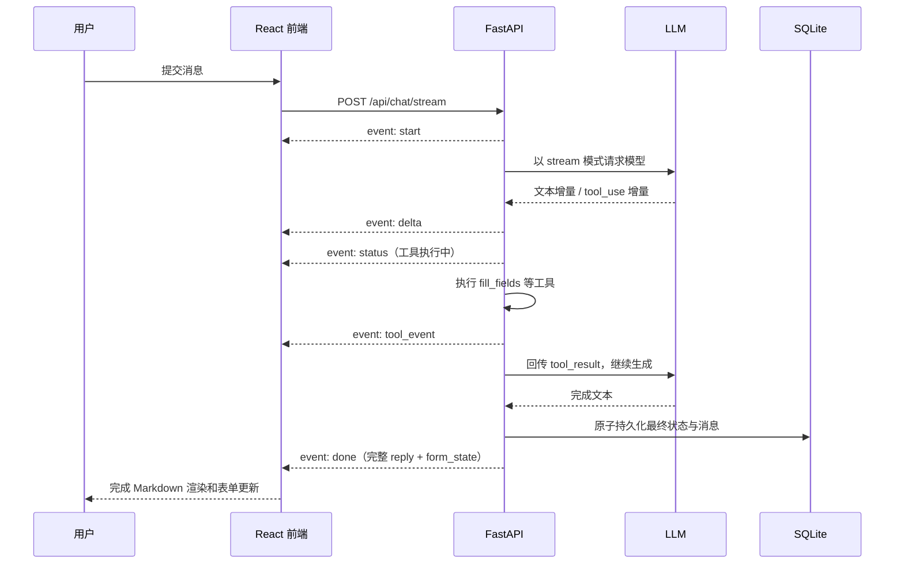

# AI 流式输出方案调研与落地建议

> 调研对象：直播间智能客服系统
>
> 术语说明：本文将“流失输出”按“流式输出（streaming output）”理解，即模型生成过程中，前端持续收到并展示增量内容。

## 1. 背景与目标

当前系统通过多轮对话采集直播间搭建需求，并在会话完成后生成交付物。现有聊天链路是：

```text
用户输入
  → 前端 POST /api/chat
  → FastAPI 校验会话归属、读取历史
  → Agent 调用 LLM，并执行 fill_fields 等工具
  → 持久化 session、message、tool_events
  → 一次性返回 reply + form_state + suggestions
```

当前实现的主要代码位置：

- 后端聊天接口：`backend/api/app.py` 的 `POST /api/chat`
- Agent 循环：`backend/agent/loop.py` 的 `run_agent`
- LLM 客户端：`backend/agent/llm.py`
- 前端请求：`frontend/src/api/client.ts` 的 `chat`
- 前端展示：`frontend/src/components/ChatPanel/ChatPanel.tsx`

补充：`POST /api/generate/{doc_type}` 当前通过 FastAPI `Response` 一次性返回 Markdown、Excel 或 Word 文件。它是文件下载接口，不是本次聊天文本流式输出的改造对象；后续如果交付物体积变大，可单独评估文件下载流。

本次调研目标：

1. 了解 AI 应用最常见的流式输出方式。
2. 根据当前 FastAPI + React + Anthropic 兼容接口的架构，选择合适方案。
3. 给出可以分阶段实施的接口、事件和异常处理约定。

## 2. “流式输出”需要解决什么问题

一次完整响应通常要等模型生成完毕、工具调用完成、状态持久化结束后才返回。用户感知到的是较长的空白等待。

真正的流式输出需要同时满足两层：

- **模型层流式生成**：LLM SDK 以 stream 模式返回 token 或事件。
- **HTTP 层持续转发**：后端将这些增量事件及时写入响应，不能等完整答案生成后再一次性返回。

只把完整 `reply` 切成几段再发送，属于“伪流式”，不会减少模型首字延迟，也无法显示真实生成进度。

## 3. 常见方案

### 3.1 SSE（Server-Sent Events）

SSE 使用一个长连接将服务端事件单向推送到浏览器，响应类型为 `text/event-stream`。事件以空行分隔，可包含 `event`、`data`、`id`、`retry` 字段；浏览器的 `EventSource` 在连接断开后默认尝试重连。

适合：AI 文本生成、进度通知、服务端状态推送等“服务端持续发、客户端主要接收”的场景。

优点：

- 协议简单，基于普通 HTTP，易于经过反向代理。
- 事件具有类型和序号，便于区分文本、工具调用、完成、错误等消息。
- 有天然的 `id` / `Last-Event-ID` 机制，可设计断线续传。

限制：

- 原生 `EventSource` 只能发起 GET，不能直接发送当前 `/api/chat` 所需的 JSON POST body。
- 原生 `EventSource` 对自定义 `Authorization` 请求头支持有限，当前 JWT 认证不能简单照搬。
- HTTP/1.1 下浏览器对同域 SSE 连接数有限；HTTP/2 可缓解该问题。

因此，本项目若采用 SSE，建议使用 **POST + `fetch` 读取 SSE 字节流**，而不是直接使用 `new EventSource()`。

### 3.2 `fetch` + `ReadableStream`

前端使用 `fetch` 发起 POST，读取 `response.body.getReader()`，按 UTF-8 解码并解析服务端持续写入的数据。服务端可以发送 SSE 格式，也可以发送 JSON Lines。

适合：需要 POST body、Bearer Token、自定义请求头、取消请求和细粒度客户端状态管理的 AI 聊天。

优点：

- 兼容当前 `POST /api/chat` 的 JSON 请求体和 `Authorization` 头。
- 可以通过 `AbortController` 主动取消生成。
- 前端可自行控制事件解析、重试、超时、UI 节流和错误展示。

限制：

- 浏览器不会自动完成 SSE 重连，需要应用自己实现。
- 必须处理“一个网络 chunk 不是一个完整事件”的情况，不能对每次 `read()` 结果直接 `JSON.parse`。
- 需要明确流结束标识和最终状态，否则难以区分正常结束与中途断开。

### 3.3 WebSocket

WebSocket 建立双向长连接，客户端和服务端都可以随时发送消息。

适合：多人协同、实时音视频控制、服务端主动通知、客户端和服务端都需要高频发送事件的系统。

对当前项目的主要问题：

- 聊天请求是“发起一次、服务端持续返回”，双向长连接能力暂时用不上。
- 连接认证、心跳、重连、会话恢复、负载均衡和连接生命周期都比 HTTP 流复杂。
- 需要额外处理连接断开时消息是否已落库、是否允许重复提交等一致性问题。

除非后续增加协同编辑、实时后台通知或多端同步，否则不建议把 WebSocket 作为第一版聊天流式方案。

### 3.4 HTTP Chunked / JSON Lines（NDJSON）

服务端持续发送多行 JSON，每行一个完整事件，例如：

```text
{"type":"delta","text":"您好"}\n
{"type":"delta","text":"，请问您的品牌名是？"}\n
{"type":"done","message_id":"m_123"}\n
```

优点是实现直接、无需 SSE 的字段语义；缺点是事件类型、重连序号、错误约定都要自行设计。它适合服务端到服务端或内部接口，也可以用于浏览器 `fetch` 流读取。

## 4. 方案对比

| 方案 | 当前 POST + JWT | 单向 AI 文本 | 自动重连 | 双向通信 | 实现复杂度 | 结论 |
|---|---:|---:|---:|---:|---:|---|
| 原生 EventSource | 弱 | 强 | 强 | 否 | 低 | 不适合直接承载当前聊天请求 |
| POST + fetch 读取 SSE | 强 | 强 | 需自实现 | 否 | 中 | **推荐** |
| POST + fetch 读取 NDJSON | 强 | 强 | 需自实现 | 否 | 中 | 可作为备选 |
| WebSocket | 强 | 强 | 需自实现 | 是 | 高 | 当前阶段不推荐 |
| 一次性 JSON | 强 | 弱 | 不适用 | 否 | 低 | 当前实现，保留作为降级接口 |

## 5. 对当前项目的推荐方案

### 推荐结论

采用 **`POST /api/chat/stream` + `fetch` + SSE 格式事件**，同时保留现有 `POST /api/chat` 作为兼容接口和降级路径。

选择理由：

1. 当前请求必须提交 `session_id`、`message`、可选 `history` 和 `updates`，POST 比原生 EventSource 更合适。
2. 当前接口使用 Bearer Token，`fetch` 可以继续注入 `Authorization` 请求头。
3. AI 聊天是单向输出，不需要 WebSocket 的双向长连接。
4. SSE 的事件类型比裸文本更适合表达 tool-use、表单状态、完成和错误。
5. 前端已有统一 API client，新增一个流式 client 不会影响普通接口和交付物下载。

### 重要边界

第一版不要把所有 Agent 内部思考或工具细节直接暴露给用户。建议只输出：

- 可展示给用户的文本增量。
- 面向 UI 的状态事件，例如“正在更新表单”。
- 工具执行后的结构化 `tool_event`。
- 最终完整状态和完成标志。

模型的隐藏思考内容、提示词、原始鉴权信息和内部异常堆栈不能进入浏览器。

## 6. 推荐端到端流程



建议的服务端顺序：

1. 校验登录、会话存在性和会话归属。
2. 发送 `start`，携带本次请求的 `request_id`。
3. 读取数据库中的历史消息，合并前端权威 `updates`。
4. 以 LLM SDK 的 stream API 执行 Agent 循环。
5. 收到文本增量时发送 `delta`。
6. 收到工具调用时先发送 `status`，执行工具后发送结构化 `tool_event`。
7. 生成结束后重新计算 `form_state` 和 `form_complete`。
8. 只有最终结果完整后才持久化 assistant 消息、工具事件和 session 状态。
9. 发送 `done` 并正常结束响应。

## 7. 接口设计建议

### 7.1 请求

```http
POST /api/chat/stream
Authorization: Bearer <token>
Content-Type: application/json
Accept: text/event-stream
```

```json
{
  "session_id": "session-id",
  "message": "品牌名是云裳",
  "history": [],
  "updates": []
}
```

### 7.2 SSE 事件格式

每个事件以空行结束，`data` 内容使用 JSON：

```text
id: req_123:0
event: start
data: {"request_id":"req_123"}

id: req_123:1
event: delta
data: {"text":"好的，我先记录品牌名。"}

id: req_123:2
event: tool_event
data: {"kind":"fill","section_id":"customer","field_id":"brand","value":"云裳"}

id: req_123:3
event: done
data: {"reply":"好的，我先记录品牌名。","form_state":{},"form_complete":false,"suggestions":[]}
```

建议事件类型：

| 事件 | 用途 | 前端动作 |
|---|---|---|
| `start` | 标记请求开始 | 创建临时 AI 消息，禁用重复发送 |
| `delta` | 文本增量 | 追加文本并节流 Markdown 渲染 |
| `status` | 工具或阶段状态 | 展示“正在更新表单”等非最终提示 |
| `tool_event` | 表单字段变更、跳过章节等 | 增量更新对应 UI |
| `done` | 最终结果 | 使用完整状态替换临时状态，落地消息 |
| `error` | 可展示的失败信息 | 结束 loading，允许重试 |

`done` 应包含完整 `reply` 和完整 `form_state`，作为最终一致性快照。即使前端因网络 chunk 丢失了部分 `delta`，也能用最终快照恢复正确状态。

### 7.3 前端解析要点

前端必须维护一个跨 `reader.read()` 调用的缓冲区：

1. `ReadableStream` 读取字节。
2. 使用 `TextDecoder` 增量解码。
3. 将数据追加到 buffer。
4. 按 `\n\n` 切分完整 SSE 事件，保留未完成片段。
5. 解析 `event`、`id` 和 `data`。
6. 根据事件类型更新临时消息、表单状态或错误状态。
7. 读到 `done` 后关闭 loading；读到 `error` 或异常断开后进入可重试状态。

## 8. 后端实现注意事项

### 8.1 FastAPI 响应

FastAPI 的 `StreamingResponse` 可以接收异步生成器或普通生成器，并持续发送响应体。异步生成器中需要包含可取消的 `await`，以便客户端断开时及时停止任务。

建议使用异步生成器，并设置：

```python
StreamingResponse(
    event_generator(),
    media_type="text/event-stream",
    headers={
        "Cache-Control": "no-cache",
        "Connection": "keep-alive",
        "X-Accel-Buffering": "no",
    },
)
```

反向代理必须关闭响应缓冲，否则后端虽然在 yield，浏览器仍可能一次性收到大量内容。

### 8.2 Agent 与 SDK

当前 `backend/agent/loop.py` 使用同步 `client.messages.create`，并且一次完整调用后才处理 `resp.content`。要做到真实 token 流式，需要：

- 使用 Anthropic 兼容 SDK 的 streaming API 或异步 streaming API。
- 将 Agent 循环改造成异步生成器，按事件 yield。
- 保留 tool-use 循环：工具调用完成后继续请求模型，并继续输出后续文本。
- 明确哪些事件可实时发送，哪些状态只能在最终完成后确认。

不要在 `StreamingResponse` 内调用同步 LLM 请求后再切片输出；这只能降低代码表面上的改动，不能改善首字延迟。

### 8.3 持久化一致性

建议把“最终状态持久化”放在 Agent 正常完成之后，并保证一次请求只提交一次最终结果。客户端断开时：

- 如果尚未完成，不要把半截 assistant 回复写成完整消息。
- 工具执行已经改变内存状态时，应根据业务决定回滚，或记录为可恢复的中间状态。
- 通过 `request_id` 或幂等键避免客户端重试造成重复消息。

## 9. 取消、异常与断线恢复

### 9.1 用户主动取消

前端为每次请求创建 `AbortController`，点击停止时调用 `abort()`。后端捕获客户端断开，停止 LLM stream 和后续工具循环，释放连接。

### 9.2 LLM 错误

将内部异常转换为稳定的错误码和用户可读文案，例如：

```json
{"code":"llm_balance_insufficient","message":"LLM 服务余额不足，请联系管理员充值后重试。"}
```

不要把 SDK 异常堆栈、请求头或上游响应原文直接发送给前端。

### 9.3 网络断开

第一版建议采用“重新发起本轮请求 + 幂等键”的恢复策略，而不是立即实现复杂的 token 级续传：

1. 服务端为每次聊天请求生成 `request_id`。
2. `done` 前断开时，服务端不写入完整 assistant 消息。
3. 前端重试时带上同一个 `request_id`。
4. 服务端检测到已完成请求时返回已保存的最终结果，避免重复执行。

如果后续确实需要断点续传，再引入 `Last-Event-ID` 和事件重放存储。

### 9.4 心跳

LLM 长时间无文本时，代理可能认为连接空闲。可以定期发送 SSE 注释行：

```text
: heartbeat

```

心跳不应被前端当作业务事件，也不能替代真正的超时和取消处理。

## 10. 分阶段实施计划

### 阶段一：协议和前端能力（低风险）

- 新增流式接口契约和事件类型。
- 前端新增 SSE parser、AbortController、临时消息状态。
- 后端先用固定测试事件验证网络传输、代理配置和 UI 行为。
- 保留 `/api/chat`，必要时通过开关回退。

### 阶段二：接入 Agent 文本流

- 将 LLM 调用切换到 streaming API。
- 把 `run_agent` 拆为可 yield 的异步 Agent loop。
- 接入 `delta`、`status`、`done` 和 `error`。
- 增加取消、超时和客户端断开测试。

### 阶段三：一致性和可观测性

- 引入 `request_id` / 幂等键。
- 记录首字时间、完成时间、取消率、错误码和 token 用量。
- 增加断线重试和最终结果恢复。
- 通过压测确认连接数、代理缓冲、SQLite 写入和并发 Agent 的边界。

## 11. 验收标准

- 用户发送消息后，首个可展示文本不需要等待完整回复。
- 文本增量不会出现乱序、重复或乱码。
- tool-use 执行后，表单状态与最终 `done.form_state` 一致。
- 点击停止后，前端 loading 结束，后端不会继续无界调用 LLM。
- LLM 余额不足、鉴权失败、超时和连接中断均有稳定可读的错误状态。
- 重试不会重复写入用户消息或 assistant 消息。
- 代理环境下不会因缓冲导致“看似流式、实际一次性到达”。
- 原有 `/api/chat` 和交付物下载功能保持可用。

## 12. 结论

当前系统最适合的路线是：**保留普通 JSON 聊天接口作为兼容与降级，新增 `POST /api/chat/stream`，使用 `fetch` 携带 JWT 读取 SSE 事件；后端再把 Agent 和 LLM 调用改造成真正的异步 streaming loop。**

这条路线既符合当前 POST + Bearer Token + 表单状态更新的实际结构，也避免为了一个单向文本流引入 WebSocket 的连接治理成本。需要特别注意：协议改成 SSE 只是第一步，只有 LLM SDK 本身以 stream 模式产生增量事件，用户才能真正看到逐步生成效果。

## 参考资料

- FastAPI：StreamingResponse  — <https://fastapi.tiangolo.com/advanced/custom-response/#streamingresponse>
- FastAPI：Stream Data — <https://fastapi.tiangolo.com/advanced/stream-data/>
- FastAPI：自定义响应与 StreamingResponse — <https://fastapi.tiangolo.com/advanced/custom-response/>
- MDN：Using server-sent events — <https://developer.mozilla.org/en-US/docs/Web/API/Server-sent_events/Using_server-sent_events>
- MDN：Fetch API / Streams — <https://developer.mozilla.org/en-US/docs/Web/API/Streams_API/Using_readable_streams>
- MDN：WebSocket — <https://developer.mozilla.org/en-US/docs/Web/API/WebSocket>
- Anthropic API：Streaming Messages — <https://docs.anthropic.com/en/api/messages-streaming>
